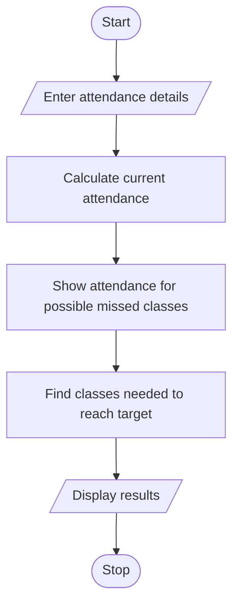

# Problem Statement

Write a Python program to calculate current attendance percentages and determine the minimum consecutive classes required to reach an eligibility threshold under different future attendance scenarios

# Algorithm

1. Start
2. Enter classes attended, classes held, required attendance percentage, and upcoming classes.
3. Calculate and display the current attendance percentage.
4. Calculate and display attendance for each possible number of missed upcoming classes.
5. Find and display how many consecutive classes must be attended to reach the required percentage.
6. Stop

   
# Flowchart

# Sample Input

Classes attended so far: 36
Classes held so far: 40
Required attendance percentage: 75
Upcoming classes: 5

# Sample Output

Current attendance: 90.0%
If you miss 0 classes: 91.1%
If you miss 1 classes: 88.9%
If you miss 2 classes: 86.7%
If you miss 3 classes: 84.4%
If you miss 4 classes: 82.2%
If you miss 5 classes: 80.0%
Consecutive classes to attend to reach threshold: 0

