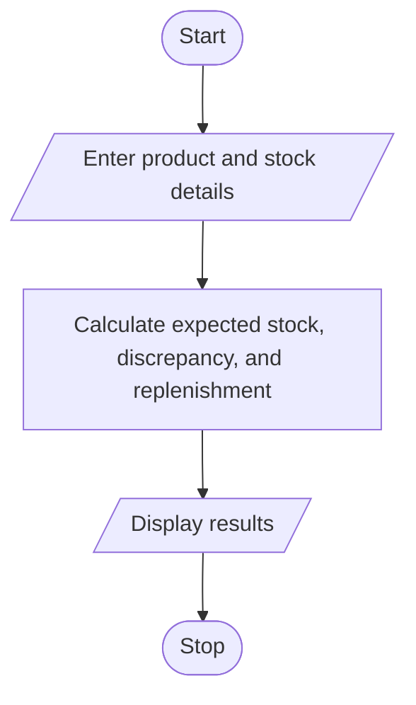

# Problem Statement

Write a program to  compare opening stock, incoming quantities, dispatched quantities, and closing stock across multiple products; detect discrepancies and calculate replenishment requirements. 

# Algorithm

1. Start
2. Enter the number of products and each product’s stock details.
3. Calculate the expected stock, discrepancy, and replenishment quantity.
4. Display the results for each product.
5. Stop

# Flowchart

# Sample Input

Number of products: 1
Product name: Pens
Opening stock: 100
Incoming quantity: 20
Dispatched quantity: 30
Recorded closing stock: 85
Minimum stock required: 50

# Sample Output

Pens: Expected stock=90, Discrepancy=-5, Replenish=0

