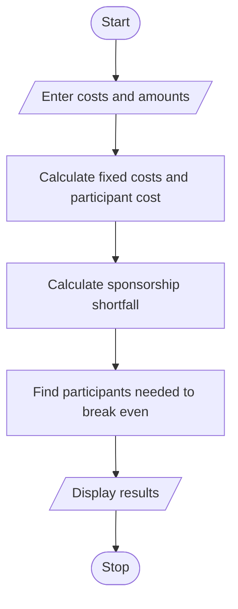

# Problem Statement

Write a python program to calculate venue, equipment, catering, transport, and certificate costs; determine participant contributions, sponsorship shortfalls, and the minimum registration count needed to break even

# Algorithm

1. Start
2. Enter the event costs, sponsorship, and contribution per participant.
3. Calculate fixed costs, participant cost, and sponsorship shortfall.
4. Calculate the minimum participants needed, if possible.
5. Display the results.
6. Stop

# Flowchart

# Sample Input

Venue cost: 1000
Equipment cost: 500
Catering cost per participant: 20
Transport cost: 300
Certificate cost per participant: 5
Sponsorship amount: 800
Contribution per participant: 50

# Sample Output

Fixed costs: 1800.00
Cost per participant: 25.00
Sponsorship shortfall: 1000.00
Minimum participants to break even: 40

