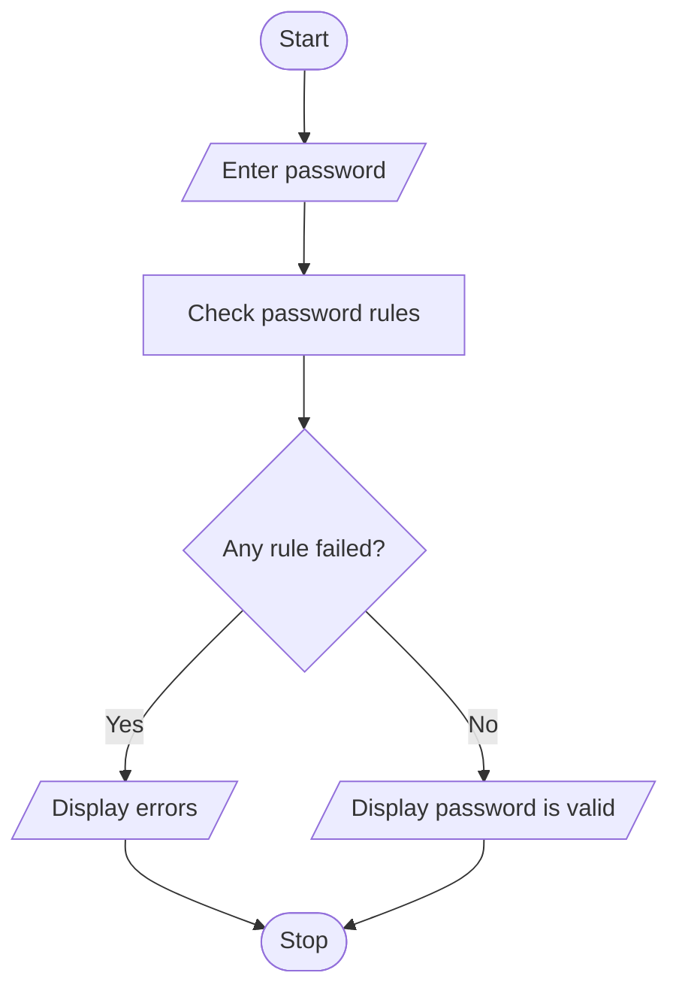

# Problem Statement

Write a program to evaluate sample password strings against minimum length, character-category, repetition, and prohibited-substring rules; explain each failed condition

# Algorithm

1. Start
2. Enter a password.
3. Check its length, uppercase letter, lowercase letter, number, and prohibited text.
4. Check whether any character repeats three times in a row.
5. If any rule fails, display the errors; otherwise, display that the password is valid.
6. Stop

# Flowchart

# Sample Input

Enter a password: Hello123

# Sample Output

Password is valid

