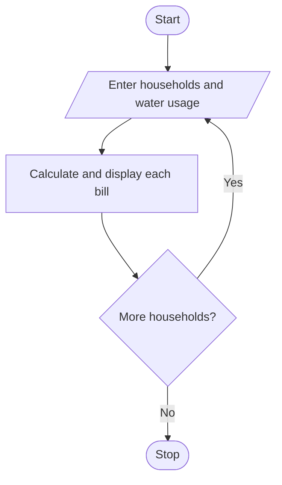

# Problem Statement

Write a program to calculate bills for multiple households using consumption slabs, fixed fees, and penalties; compare consumption patterns and identify excessive usage

# Algorithm

1. Start
2. Enter the number of households.
3. For each household, enter its name and water usage.
4. Calculate and display the bill.
5. If usage is above 60 units, display a warning.
6. Repeat for the remaining households.
7. Stop

# Flowchart

# Sample Input

Number of households: 2
Household name: Ravi
Water usage: 25
Household name: Mina
Water usage: 65

# Sample Output

Ravi usage: 25.0 Bill: 175.0
Mina usage: 65.0 Bill: 930.0
Excessive usage

