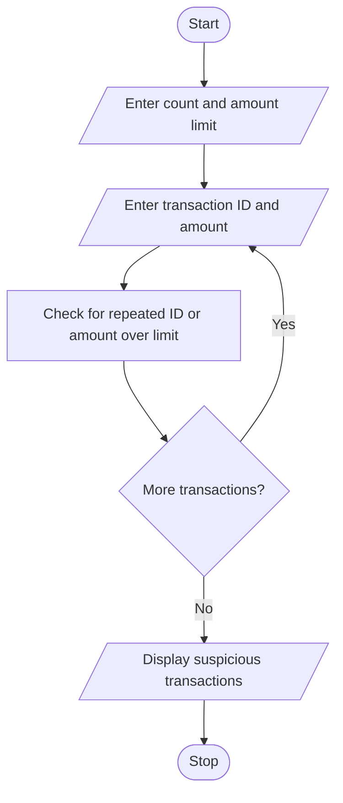

# Problem Statement

Write a program to Process transaction identifiers and amounts in a list, detect duplicate transactions, identify threshold violations, and generate a list of suspicious entries

# Algorithm

1. Start
2. Enter the number of transactions and the amount limit.
3. Enter each transaction’s ID and amount.
4. Check whether the ID is repeated or the amount is above the limit. If so, mark it suspicious.
5. Display the suspicious transactions.
6. Stop

# Flowchart

# Sample Input

Number of transactions: 3
Amount limit: 500
Transaction ID: T01
Amount: 200
Transaction ID: T02
Amount: 600
Transaction ID: T02
Amount: 300

# Sample Output

Suspicious transactions: [('T02', 600.0), ('T02', 300.0)]

