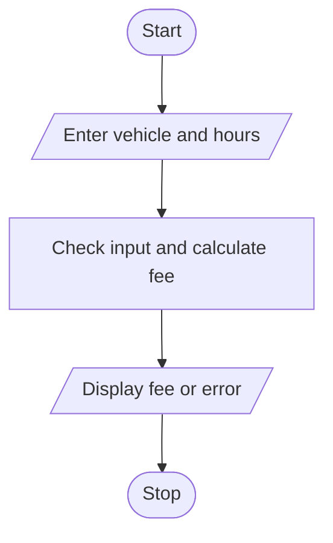

# Problem Statement

Write a program to calculate charges from entry and exit times, vehicle categories, overnight parking, daily limits, and penalty conditions while validating time inputs. 

# Algorithm

1. Start
2. Enter the vehicle type, entry hour, and exit hour.
3. Check the hours and vehicle type.
4. Calculate and display the parking hours and fee, or show an error.
5. Stop

# Flowchart

# Sample input

Vehicle type (car/bike): car
Entry hour (0-23): 9
Exit hour (0-23): 12

# Sample Output

Parking hours: 3
Parking fee: 150

