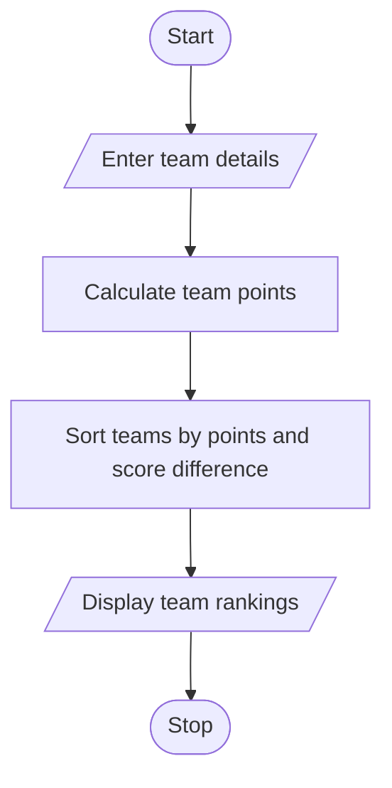

# Problem Statement

Write a program to store match results and team scores, calculate total points and tie-break values, and produce rankings under a specified competition policy. 

# Algorithm

1. Start
2. Enter the number of teams.
3. For each team, enter its name, wins, draws, and score difference.
4. Calculate points: wins × 3 + draws.
5. Sort teams by points, then by score difference.
6. Display each team’s rank and points.
7. Stop

# Flowchart

# Sample Input

Number of teams: 3
Team name: Tigers
Wins: 3
Draws: 1
Score difference: 5
Team name: Eagles
Wins: 2
Draws: 2
Score difference: 8
Team name: Bears
Wins: 3
Draws: 1
Score difference: 2

# Sample Output

1 Tigers Points: 10
2 Bears Points: 10
3 Eagles Points: 8

