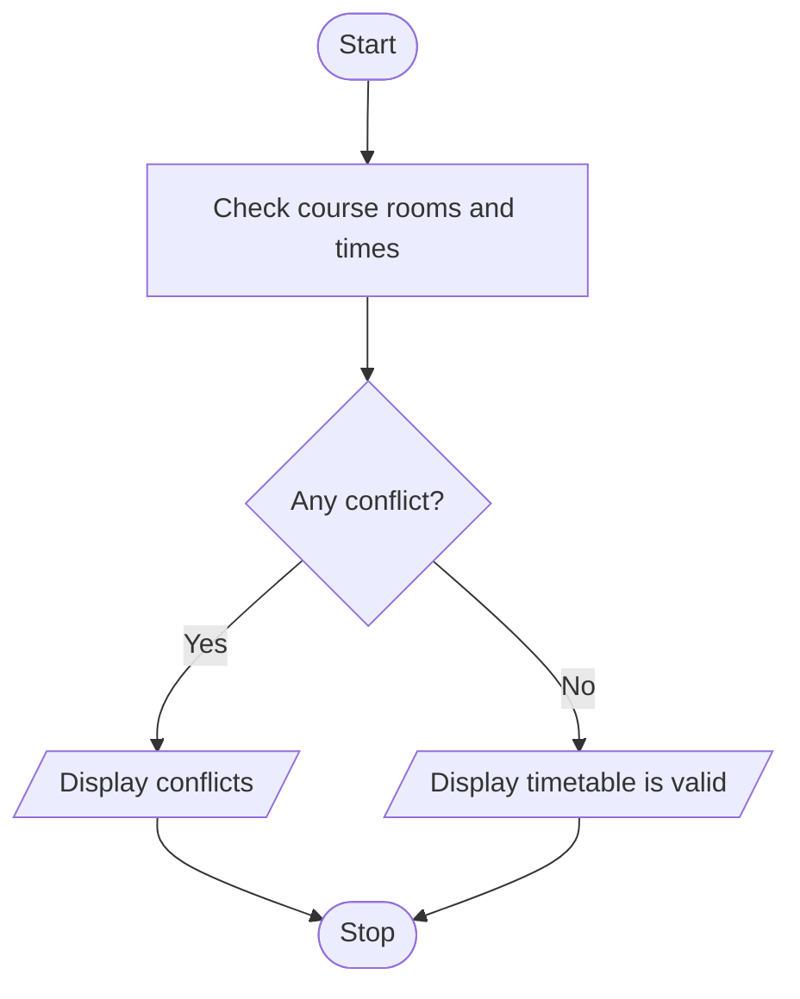

# Problem Statement

Write a program to compare course schedules represented by strings and tuples, detect overlapping periods, identify unavailable rooms, and validate a proposed timetable. 

# Algorithm

1. Start
2. Set the available rooms and course details.
3. Check each course for an unavailable room.
4. Compare courses for overlapping times on the same day.
5. Display any conflicts, or display that the timetable is valid.
6. Stop

# Flowchart

# Sample Input

Math, Monday, 9–10, Room 1
Science, Monday, 10–11, Room 1

# Sample Output

Timetable is valid

