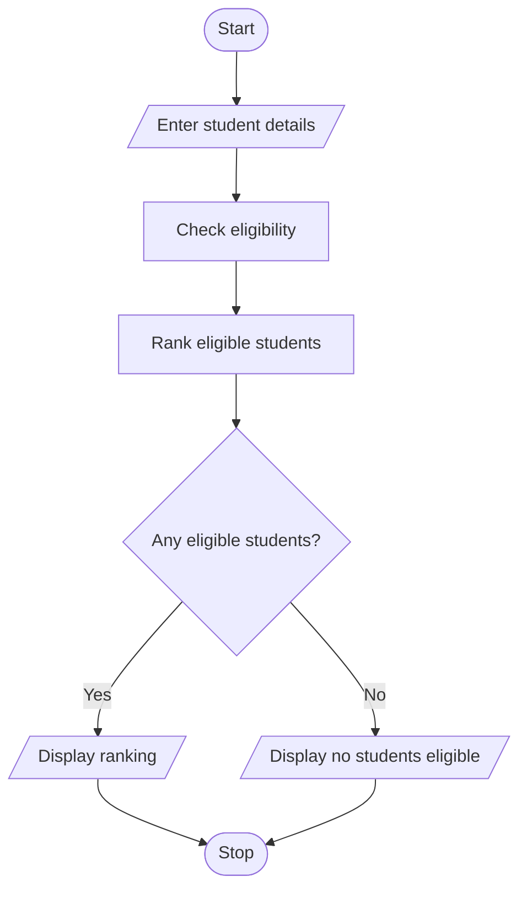

# Problem Statement

Write a program to design a system that evaluates applicants using aggregate marks, subject-wise minimum scores, attendance, and income criteria, ranks eligible students, and resolves ties using predefined rules. 

# Algorithm

1. Start
2. Enter each student’s name, marks in three subjects, attendance, and family income.
3. Check eligibility: average marks at least 80, every subject mark at least 60, attendance at least 75%, and income no more than 500,000.
4. Rank eligible students by average marks, attendance, then lower family income.
5. Display the ranking, or display that no students are eligible.
6. Stop

# Flowchart

# Sample Input

How many students: 1
Student name: Asha
Subject 1 marks: 85
Subject 2 marks: 90
Subject 3 marks: 80
Attendance percentage: 90
Family income: 400000

# Sample Output

Scholarship ranking:
1 Asha 85.0%
